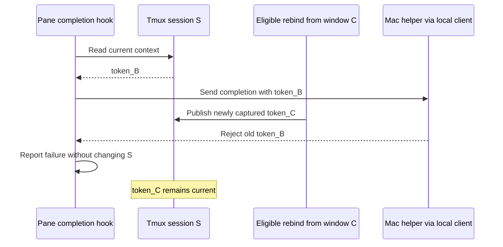
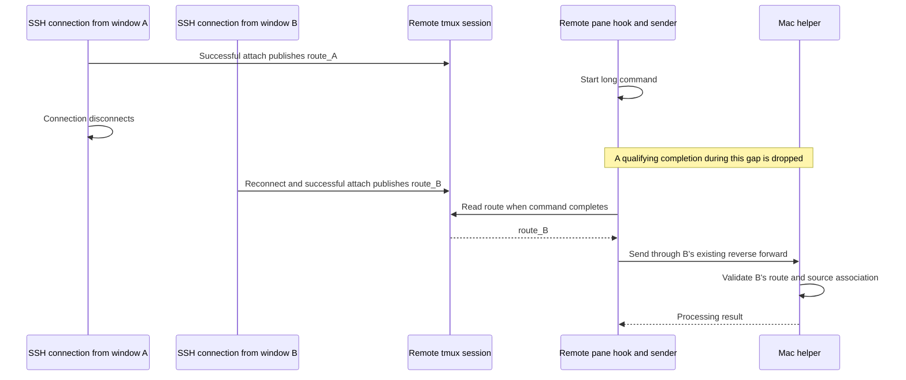

# Binding State and Recovery

**Status:** Initial design. These sequences describe selected behavior and implementation requirements. They do not establish end-to-end delivery. The protocol codecs and helper binding/capture foundation exist; shell integration, tmux publication, completion-time source validation, transport, and notification delivery remain to be integrated.

This document explains how a command's notification destination survives shell caching, tmux attachment changes, and window closure. The [initial design](initial-design.md) owns scope and policy; this companion expands its state transitions for implementation and review. The [implementation plan](implementation-plan.md) records progress, and the [validation matrix](validation-matrix.md) records required evidence.

## Identify the objects before following the state

| Object | Meaning and lifetime |
| --- | --- |
| Zed window A or B | A notification destination. Detaching a tmux client leaves the window available; closing the window makes its retained source object unusable. |
| Terminal and its ordinary Zsh shell | One terminal in a Zed window. The shell owns a non-exported binding cache, and each command retains the token selected at launch. |
| Tmux session S | Persistent panes and their shells. S owns one current notification context shared by its panes, even when no client is attached. |
| Tmux client attachment | A terminal's attachment to S. Eligible entry can replace S's context; detachment preserves the selected context. |
| Helper binding token | An opaque lookup key for a retained source window in the Swift helper. Several different tokens may refer to the same window. A stored token string is not proof that its source remains valid. |
| SSH notification connection | A registered route through one interactive SSH connection to a captured Mac window. Remote tmux stores the current route; local tmux uses a helper token directly. |
| Issued notification | Retains the association selected when it was issued. Later attachment changes and rebinding cannot redirect its click target. |

Destroying tmux session S ends its panes and removes its session context. Closing a terminal attachment can leave S running. Neither operation itself closes the source Zed window. A newly created session needs its own eligible entry and context publication.

The helper follows the associated Zed app instance. Closing window B leaves other windows' associations usable and does not stop the helper. Quitting that Zed app instance discards all its bindings; a later launch establishes fresh associations.

Window focus controls suppression at the window level. If B is foreground, a qualifying event associated with B is suppressed even when another terminal tab is visible. Exact terminal-tab or pane visibility is outside this design.

## Four terminals in one window

Window B can contain all four workflows concurrently. They share the Mac helper and can refer to the same source window while maintaining separate state.

| Terminal in B | State selected for completion | Recovery scope |
| --- | --- | --- |
| Ordinary local shell | Token retained by that command at launch | Calling shell's future-command cache |
| Local tmux session S | S's current helper token at qualifying completion | Session-wide rebind or eligible reattachment |
| Plain remote shell | Its registered SSH connection's association | Connection-wide rebind, or reconnect after connection loss |
| Remote tmux session R | R's current registered SSH route at qualifying completion | Eligible reattachment selects a route; remote rebind updates that connection |

Attaching S from window A moves S's future completion destination to A. B's ordinary local shell, another local tmux session, and separate SSH connections retain their own associations. Remote rebind affects every session routed through that same connection.

All associations targeting B become unusable if B closes. Closing B is different from detaching S's client in B. Detachment alone does not invalidate an ordinary shell's cache or the helper's window object.

## Local tmux: latest eligible attachment wins

Each successful eligible attachment publishes its captured context to the actual session selected by tmux. The latest successful publication wins, including when another client remains attached. Detachment preserves that destination; there is no automatic restoration of an earlier attachment's binding. Entry from an excluded terminal leaves the existing context unchanged and establishes no new notification context.

An excluded client can view the same persistent panes without changing their existing notification destination. Its attachment does not disable the session's previously established notifications; pane-level exclusions and explicit opt-out still apply.

An eligible entry whose capture fails proceeds without publishing a replacement. A previously valid context remains selected. Explicit manual rebind has a different failure rule: it marks the session association unavailable rather than retaining the association the user intended to replace.

```mermaid
sequenceDiagram
    participant A as Eligible terminal in window A
    participant B as Eligible terminal in window B
    participant S as Tmux session S
    participant P as Pane Zsh hook
    participant H as Mac helper via local client
    A->>H: Capture source A
    H-->>A: token_A
    A->>S: Successful attach publishes token_A
    P->>P: Start long command
    B->>H: Capture source B
    H-->>B: token_B
    B->>S: Successful attach replaces context with token_B
    Note over A,S: A may still be attached
    B->>S: Detach client
    Note over S,H: Window B remains open; context remains token_B
    P->>S: Read context at qualifying completion
    S-->>P: token_B
    P->>H: Complete using token_B
    H->>H: Validate retained B and apply notification policy
    H-->>P: Processing result
```

The command uses B even though it started while S pointed to A. Its elapsed time covers the whole command. Continued local delivery while detached remains subject to the duration threshold, exclusions, valid source, and foreground suppression.

## Window closure: discover an unusable source on use

When B closes, its retained source object becomes unusable. The helper detects that condition when validating a later completion request. It also rejects a token absent from its registry, such as after helper restart. A known token with an unavailable source and an unknown token both prevent notification, but their failure reasons remain distinguishable.

This design needs no detach hook to invalidate a window binding. No continuous polling is required: if no event arrives after closure, source validation can wait until a request uses the token. The helper may discard a confirmed invalid registry entry; exact eviction mechanics remain an implementation choice.

```mermaid
sequenceDiagram
    participant B as Zed window B
    participant S as Tmux session S
    participant P as Pane Zsh hook
    participant H as Mac helper via local client
    participant A as Eligible terminal in window A
    Note over S,H: S stores token_B; helper retains source B
    B->>B: Window closes
    P->>S: Read context at qualifying completion
    S-->>P: token_B
    P->>H: Complete using token_B
    H->>H: Lookup token and validate retained source
    H-->>P: Reject unavailable source or unknown token
    P->>P: Skip notification and report recovery guidance
    Note over S,H: S may still store token_B; helper cannot deliver with it
    A->>H: Explicit rebind captures A
    H-->>A: Fresh token_A2
    A->>S: Replace context with token_A2
    P->>S: Read context for a later qualifying completion
    S-->>P: token_A2
```

The helper's error response does not modify tmux. The Rust local client returns the result to the pane hook, which handles the diagnostic. The session option can retain the rejected token until rebind or eligible reattachment replaces it. Repeated requests still undergo helper validation, so the stored string cannot authorize delivery on its own.

A remaining client in A does not automatically regain ownership when B closes. Recovery selects a fresh association deliberately. A command still running when recovery occurs uses the replacement context at completion; the already skipped event is not replayed.

## A late failure must preserve a newer binding

Completion hooks leave the tmux session context untouched on delivery rejection. This prevents an old response from clearing a context installed concurrently by another attachment or rebind.



Manual rebind and attachment publication still need coordinated context replacement. Failed explicit rebind must invalidate the context it attempted to replace without erasing a newer successful publication. The exact synchronization mechanism remains to be selected and tested.

## Ordinary local shells: clear and retry the shell cache

An ordinary local shell owns a cache distinct from tmux session state. Its first eligible command captures the source; subsequent launches reuse the cache without invoking the local client or Accessibility. The command keeps its launch-time token even if manual rebind changes the cache later.

Helper restart illustrates cache recovery without closing the shell's window:

```mermaid
sequenceDiagram
    participant Z as Ordinary local Zsh in window A
    participant C as Short-lived Rust local client
    participant H as Mac helper
    Note over Z,H: Shell cache contains token_A1
    H->>H: Restart with an empty binding registry
    Z->>Z: Launch command using cached token_A1
    Z->>C: Qualifying completion with token_A1
    C->>H: Complete request
    H-->>C: unknown_binding
    C-->>Z: Structured failure result
    Z->>Z: Clear matching cache and report retry guidance
    Note over Z,H: Failed completion is skipped; no recapture now
    Z->>C: Next eligible launch requests bind
    C->>H: Capture foreground source A
    H-->>C: Fresh token_A2
    C-->>Z: token_A2
    Z->>Z: Cache token_A2 and launch command
```

The Zsh hook changes the calling shell's variable; an external executable cannot update that variable directly. A failed response for a command's old token must not clear a newer cache installed by rebind. Failed capture leaves the cache empty for another eligible launch.

An unknown token or unusable source triggers cache recovery. A transport timeout alone does not prove that the token is stale. Recovery must distinguish source-association failure from delivery failure and must preserve command exit status.

Pane shells do not acquire this ordinary-shell recapture behavior. A tmux pane uses the shared context at completion and recovers through explicit rebind or eligible reattachment. Capturing at pane completion could choose an unrelated foreground window.

## Remote tmux: replacement routes also need a live connection

Remote tmux shares session-context lookup and latest eligible attachment selection. Its context names a registered SSH route rather than a direct local helper token. Detachment preserves the selected route, but a closed SSH connection makes that route unavailable even if the source Zed window remains open.



The illustrated command continues through the gap and finishes after B reattaches. It is not a queued event. A command that completed during the gap stays dropped. If B later disconnects while A remains connected, the session does not automatically revert to route_A.

Remote manual rebind recaptures the current connection's Mac window through the existing route. It affects all work associated with that connection. It cannot create a replacement SSH connection; connection loss requires manual reconnect and reattachment.

## Diagnostics and recovery messages

Missing or invalid associations skip notification rather than produce a generic notification with unreliable suppression or click focus. Commands and attachments continue. The approved message templates are:

Ordinary local source binding failure:

```text
zed-notify: Notifications unavailable: source binding failed. The next eligible command will retry, or run `zed-notify rebind` with the intended Zed window focused.
```

Local tmux binding unavailable:

```text
zed-notify: Notification skipped: session binding is unavailable. Reattach from the intended Zed window, or focus it and run `zed-notify rebind`.
```

Remote source binding unavailable with an active connection:

```text
zed-notify: Notification skipped: source binding is unavailable. Focus the intended Zed window and run `zed-notify rebind`.
```

Remote notification connection unavailable:

```text
zed-notify: Notification skipped: notification connection is unavailable. Reconnect and reattach if using tmux.
```

`zed-notify rebind` remains the proposed command spelling. Source-specific templates describe association recovery; transport failures need a reason appropriate to the failure and must not incorrectly promise recapture as their remedy.

Repetition detection belongs to the persistent Zsh shell, with a last-reported failure reason per operation. Report the first failure and a changed reason, suppress repetitions, and clear that operation's failure state when the operation succeeds. A successful ordinary command does not itself demonstrate notification recovery. Each pane has its own diagnostic state, so suppression is per shell, not session-wide. New shells may report the failure again. Explicit manual rebind always reports success or failure.

## Implementation and validation boundaries

The sequences specify behavior to implement. The helper currently looks up tokens before dispatching completion and has retained-window capture/validity support. The Rust socket client and Swift server provide bind and completion exchanges. The refactored Swift server still needs behavior review and verification; real Rust-to-Swift socket integration remains pending. Completion-time source rejection, notification actions, shell recovery, and tmux integration remain to be implemented.

Validation must distinguish window closure from client detachment; preserve delivery while local tmux is detached; cover simultaneous clients and excluded entry; reject stale tokens without clearing newer context; verify ordinary cache retry and failed rebind; and run the four-terminal example with independent routing. Local and remote tmux each need end-to-end transport evidence. Codec interoperability alone does not establish these lifecycle behaviors.
