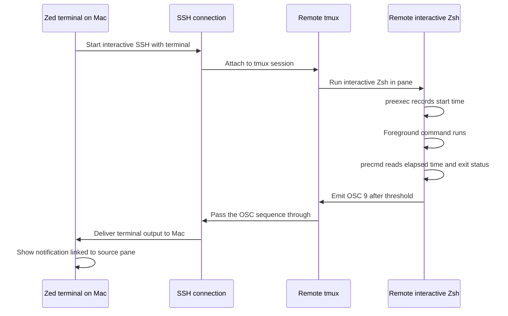

# Prospective Design: Remote Command Notifications in Zed

**Status:** Prospective design; implementation and delivery backend are not approved.

**Last reviewed:** 2026-10-31.

## Purpose

This design describes how to notify on the Mac when a long-running foreground command finishes in a remote interactive Zsh session viewed through Zed, especially an AL2023 shell inside remote tmux. It records the preferred native-terminal path, a bridge alternative, and the decisions needed before implementation.

The review question is whether to pursue native OSC 9 notification handling in Zed or build a Mac-side notification bridge for earlier availability.

## Problem and goals

The local Zsh process sees an interactive SSH connection as one foreground command. Its `precmd` hook runs when SSH returns control, such as after logout or detach, so it cannot report completion of individual commands in a remote tmux pane while the connection remains open.

The design should report completion from the remote interactive shell while the SSH and tmux sessions remain attached. It should include the remote command's exit status and elapsed time, avoid sending the full command line by default, and let the notification lead back to the Zed terminal that produced it.

The first version targets foreground commands in interactive Zsh shells. It does not track background jobs, commands in detached panes after the notification client disconnects, or shells other than Zsh. A pager or TUI remains active until it exits; the notification should arrive after the foreground program returns control to Zsh.

## Proposed native architecture

A remote Zsh hook measures a command from `preexec` to `precmd`. After a configurable minimum duration, provisionally 30 seconds, it creates a short notification payload with duration and exit status. The payload should omit command text and sensitive paths by default.

The hook emits an OSC 9 notification sequence to its terminal. SSH carries the terminal output to the Mac. Remote tmux must pass the sequence through, using its passthrough support where required. Zed's regular integrated terminal parses the sequence and presents a Zed notification associated with the source terminal pane.

This design makes Zed the notification receiver. The remote shell does not need to determine whether its client is an Alacritty application. A Zed-origin environment marker is optional policy for limiting when the hook emits; it is not required for the notification path itself.

Zed's current regular-terminal documentation does not describe OSC 9 notifications, and the upstream request reports that forwarding is unsupported. Native delivery therefore requires Zed-side support. The existing bell notification behavior documented for Terminal Threads is a separate feature and does not satisfy this regular-terminal flow.

## Environment and session behavior

The hook can be sourced by remote `~/.zshrc` for interactive Zsh panes. No separate daemon is needed on AL2023 for completion detection. Existing shells need to source the hook or be restarted after installation.

If notifications should be limited to sessions originating in Zed, the Mac terminal can set a marker such as `ZED_INTEGRATED_TERMINAL=1`. SSH must be configured to send the marker and the remote SSH server must accept it. Remote tmux must make the marker available to new panes. This adds SSH and tmux configuration, so the initial design does not require the marker.

A notification can reach Zed only while its terminal is attached to the SSH/tmux output path. A command that completes after detachment has no attached Zed terminal to receive the OSC sequence. Supporting durable notifications for detached work would require a separate event queue or local notification bridge.

## Delivery alternatives

| Option | Advantages | Costs and limitations |
| --- | --- | --- |
| Native OSC 9 handling in Zed | Uses the terminal output path across SSH; can identify and focus the originating Zed pane; no Mac helper process | Requires Zed core support; remote tmux passthrough must work; terminal notification policy and payload validation belong in Zed |
| Mac-side notification bridge | Can provide macOS notifications without waiting for Zed OSC 9 support | Requires a local helper, a reverse SSH-forwarded channel, connection lifecycle handling, and a separate notification UI; it does not inherently focus the source Zed pane |
| Local hook that watches SSH | Simple and requires no remote code | Reports only when SSH exits or detaches, so it does not meet the per-command requirement |

The preferred end state is native OSC 9 handling in Zed because the user wants an alert associated with the remote terminal they are already using. The bridge remains a fallback if per-command alerts are needed before Zed support is available.

## Failure behavior and security

If the remote pane is not running interactive Zsh, the Zsh hook does not run. If tmux blocks passthrough, Zed receives no notification. If Zed does not support OSC 9, the sequence cannot create a native Zed notification. These cases should be diagnosable without printing notification escape sequences into the shell prompt.

The hook should report interruption or nonzero exit status rather than labeling every completion as success. It should avoid duplicate alerts when the user detaches or reattaches. Background and detached command completion remain outside the initial scope.

Zed should treat OSC 9 content as untrusted terminal output, enforce a payload size limit, strip control characters, and avoid actions that execute commands or open arbitrary links. The initial notification should contain only a generic completion message, elapsed time, and exit status. A bridge implementation should bind its listener to loopback and accept events only through the SSH-forwarded channel; it must not expose a public notification endpoint or store credentials.

## Validation plan

Validate plain interactive SSH and remote tmux panes separately. In tmux, verify that new Zsh panes load the hook and that OSC passthrough reaches an attached client. Run short and long foreground commands, a command that exits nonzero, a pager or TUI, and a long command interrupted with Ctrl-C. Confirm that no alert arrives before a foreground program exits, that the notification includes the correct status, and that detaching does not produce a misleading per-command success alert.

If marker gating is selected, separately verify SSH `SendEnv` and server `AcceptEnv` behavior and tmux environment propagation. If the Mac-side bridge is selected, validate tunnel teardown, reconnects, duplicate suppression, and behavior when the local helper is unavailable.

## Open decisions

- Can and will Zed add OSC 9 support to the regular terminal, including source-pane attribution and focus behavior?
- Should the project wait for native Zed support, or implement the Mac-side bridge as an interim path?
- What command duration threshold and notification sound or visual policy should be configurable?
- Should interrupted commands notify by default, and how should detached/background work be handled later?
- Is a Zed-origin environment marker needed, given the SSH server and tmux configuration it requires?

## References

- [Zed terminal OSC 9 notification discussion](https://github.com/zed-industries/zed/discussions/47726)
- [Zed built-in terminal documentation](https://zed.dev/docs/terminal)
- [Zed Terminal Threads notification behavior](https://zed.dev/docs/ai/terminal-threads)
- [tmux manual](https://man.openbsd.org/OpenBSD-current/man1/tmux.1)
- [OpenSSH client configuration](https://man.openbsd.org/ssh_config)
- [OpenSSH server configuration](https://man.openbsd.org/sshd_config)
